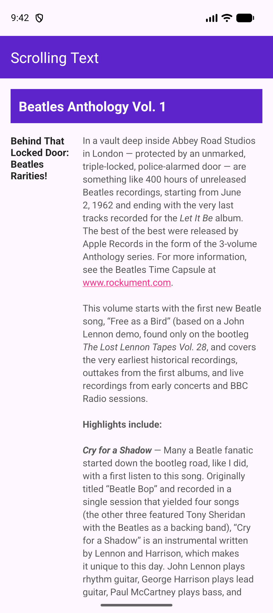
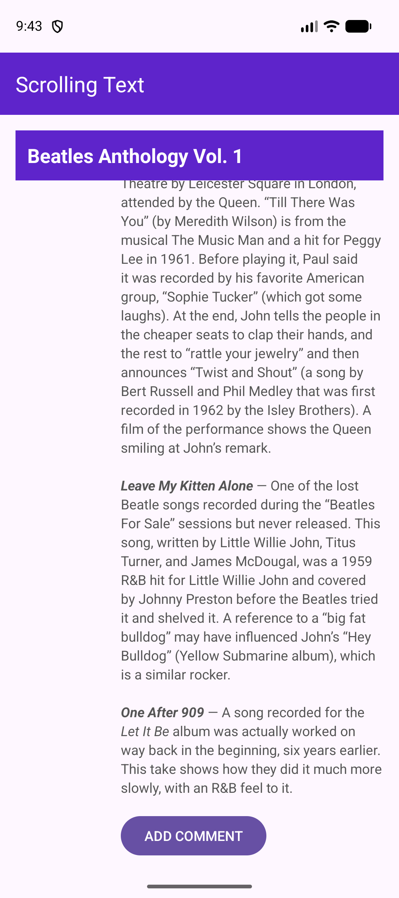

# ScrollingText

An Android application demonstrating how to display long, scrollable text content using `ScrollView` and formatted HTML strings in XML layouts.

## Features

- **Fixed Article Header**: The main article title ("Beatles Anthology Vol. 1") remains fixed at the top while the body text scrolls underneath.
- **Scrollable Content**: Uses a `ScrollView` to gracefully handle large volumes of text on devices of any screen size.
- **Rich Text Formatting**: Demonstrates HTML tags within string resources (`<b>`, `<i>`, HTML entities) and auto-linking for web URLs (`android:autoLink="web"`).
- **Responsive Layout**: Structured using nested `LinearLayout` containers with weight properties for side-by-side subheadings and body text.
- **Modern Edge-to-Edge Support**: Handles system bar insets dynamically using `EdgeToEdge` and `ViewCompat.setOnApplyWindowInsetsListener`.
- **Interactive Button**: Includes an "ADD COMMENT" button at the bottom of the article triggering a feedback `Toast` message.

## Screenshots

  
  &nbsp;&nbsp;&nbsp;&nbsp;
  

## Project Structure

- **[`MainActivity.java`](app/src/main/java/com/example/scrollingtext/MainActivity.java)**: Entry point activity handling Edge-to-Edge window insets and button click events.
- **[`activity_main.xml`](app/src/main/res/layout/activity_main.xml)**: Layout containing the Toolbar, pinned Header, ScrollView, Subheadings, Article Body, and Comment Button.
- **[`strings.xml`](app/src/main/res/values/strings.xml)**: Stores the article title, subheading, HTML-formatted article body, and Toast messages.

## Getting Started

### Prerequisites

- **Android Studio**: Ladybug / Hedgehog or newer
- **JDK**: 17+
- **Minimum SDK**: 24 (Android 7.0)
- **Target SDK**: 34 or higher

### Building & Running

1. Clone or open the project in **Android Studio**.
2. Sync the project with Gradle files.
3. Select an Android Emulator or connected physical device.
4. Click **Run** (`Shift + F10` or click the green Play button).

## License

This project is created for demonstration and learning purposes.
